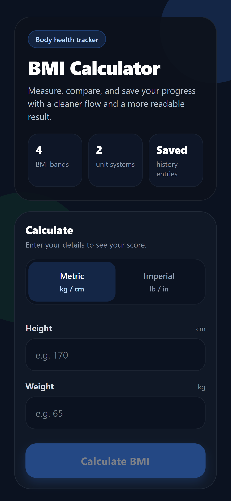
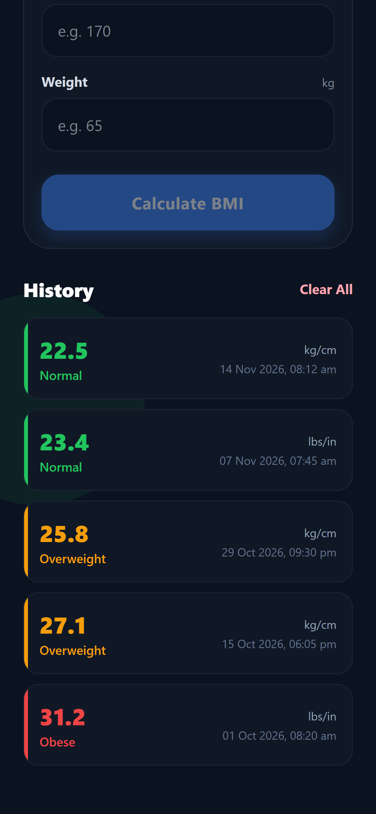

# 📊 BMI Calculator

A premium, cross-platform BMI Calculator built with React Native and Expo. Calculate your Body Mass Index with support for both Metric and Imperial units, visualize your result with interactive gauge charts, track your history over time, and get personalized health tips — all in a clean, dark-themed UI.

---

## ✨ Features

- **Accurate BMI Calculation** — supports both Metric (kg/cm) and Imperial (lbs/in) units
- **Dual Gauge Visualization** — toggle between a curved arc gauge (SVG + trigonometry) and a horizontal bar gauge
- **BMI History Tracker** — every calculation is saved locally on-device using AsyncStorage, with the ability to clear history
- **Personalized Health Tips** — expandable, category-specific tips (Underweight / Normal / Overweight / Obese)
- **Smooth Animations** — result card fades and slides in using React Native's Animated API
- **Polished Dark UI** — custom color system, glow effects, focus states, and micro-interactions throughout

---

## 🛠️ Tech Stack

| Layer | Technology |
|---|---|
| Framework | React Native (Expo) |
| Language | TypeScript |
| Navigation | Expo Router |
| Charts | react-native-svg (custom-built gauges) |
| Storage | @react-native-async-storage/async-storage |
| Animations | React Native Animated API |

---

## 📱 Screenshots

> _Add a few screenshots here once you have them — drag images into this section on GitHub, or place them in a `/screenshots` folder and reference them like:_
>
> ```md
> 
> 
> 
> ```

---

## 🚀 Getting Started

### Prerequisites
- [Node.js](https://nodejs.org/) installed
- [Expo Go](https://expo.dev/go) app installed on your phone (iOS/Android)

### Installation

```bash
# Clone the repository
git clone https://github.com/YOUR-USERNAME/bmi-calculator.git
cd bmi-calculator

# Install dependencies
npm install

# Start the development server
npx expo start
```

Scan the QR code shown in your terminal using the **Expo Go** app to run it on your phone.

---

## 📂 Project Structure

```
BMICalculator/
├── app/
│   ├── _layout.tsx          # Root layout, status bar config
│   └── (tabs)/
│       └── index.tsx        # Main screen — inputs, calculation, results
├── components/
│   ├── BarGauge.tsx         # Horizontal bar gauge visualization
│   ├── CurveGauge.tsx       # SVG arc gauge with needle
│   └── HealthTips.tsx       # Expandable health tips card
├── constants/
│   └── healthTips.ts        # Health tips data by BMI category
├── assets/                  # Icons, splash screen images
├── app.json                 # Expo app configuration
└── package.json
```

---

## 🧮 How BMI Is Calculated

**Metric:** `BMI = weight(kg) / height(m)²`

**Imperial:** `BMI = (weight(lbs) / height(in)²) × 703`

| BMI Range | Category |
|---|---|
| Below 18.5 | Underweight |
| 18.5 – 24.9 | Normal |
| 25 – 29.9 | Overweight |
| 30 and above | Obese |

---

## 📄 License

This project is licensed under the MIT License — see the [LICENSE](./LICENSE) file for details.

---

## 🙏 Acknowledgements

Built as a learning project to explore React Native, Expo, TypeScript, and mobile app development from the ground up.